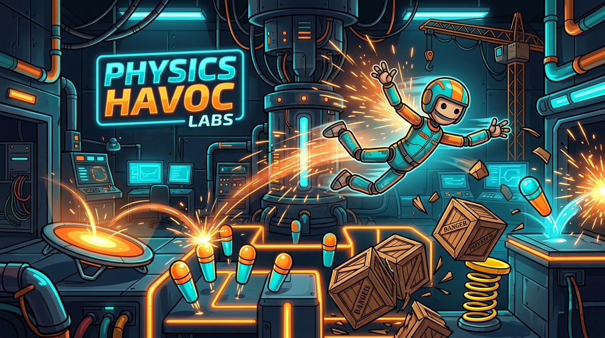

# 🕹️ Ragdoll Sandbox — Laboratório Interativo de Física 2D

[](https://github.com/leonardoconstantino/ragdoll-sandbox/actions/workflows/deploy.yml)
[](https://react.dev/)
[](https://vitejs.dev/)
[](https://brm.io/matter-js/)
[](https://tailwindcss.com/)
[](https://opensource.org/licenses/MIT)

> Um laboratório de testes físicos 2D moderno, visceral e altamente interativo construído com **React 19**, **Matter.js** e **Canvas HTML5**, focado em feedback tátil ("juice"), performance a 60 FPS estáveis e experimentação sandbox em tempo real.

---

### 🌐 [**👉 CLIQUE AQUI PARA JOGAR AGORA (LIVE DEMO)**](https://leonardoconstantino.github.io/ragdoll-sandbox/)

---

## 📸 Visão Geral



---

## ✨ Principais Funcionalidades

- **🦴 Ragdoll Anatômico Articulado de 14 Corpos**:
  - Cabeça, tórax, abdômen, pelve, braços, antebraços, coxas, canelas e pés interligados por *constraints* elásticas com rigidez balanceada e limites angulares naturais.
  - Multi-ragdoll: capacidade de invocar múltiplos bonecos simultaneamente para testes de colisão composta.

- **🛡️ Motor Anti-Lag & Evicção Inteligente (Proteção 60 FPS)**:
  - **Limite FIFO Configurável**: teto de objetos simultâneos (30, 60, 100, 200 ou Ilimitado). Ao ultrapassar a cota, os objetos mais antigos são desmaterializados suavemente.
  - **Tempo de Vida Útil (TTL)**: limpeza temporal automática (15s, 30s, 60s, 2min ou desativado), com alerta visual pulsante nos últimos segundos de vida.
  - **Void Killer**: corpos arremessados para fora dos limites visíveis são reciclados instantaneamente, evitando desperdício de memória e processamento.

- **💥 Física Tátil & Efeitos Visuais ("Juice FX")**:
  - Câmera com *screen-shake* dinâmico proporcional à magnitude dos impactos e explosões.
  - Sistema de partículas com faíscas incandescentes, detritos de madeira, fumaça volumétrica e poeira de choque.
  - Síntese de áudio procedural e espacial em tempo real via **Web Audio API** nativa (sem dependências de áudios externos).

- **🌪️ Modos de Força & Campos Gravitacionais**:
  - Gravidade Terrestre (padrão), Gravidade Lunar suave, Hiper-Gravidade de Júpiter e Gravidade Invertida.
  - Gravidade Zero (flutuação livre espacial).
  - Vórtice Repulsor / Atrator gravitacional.
  - Tempestade de Vento Turbulento com oscilação contínua de arrasto.

- **🎪 6 Arenas & Ambientes Pré-Construídos**:
  1. **Sala de Testes Padrão**: plataformas, rampas e caixas para experimentação livre.
  2. **Pinball Extremo**: *bumpers* circulares de alta restituição elástica e trilhos verticais.
  3. **Desafio Trampolim**: superfícies com coeficiente elástico amplificado para arremessos ao infinito.
  4. **Escadaria de Impacto**: degraus calculados para cascatas de colisões sucessivas.
  5. **Pêndulo de Demolição**: esfera maciça presa por haste oscilante com grande momento de inércia.
  6. **Vórtice Gravitacional**: forças centrípetas que aceleram objetos em espiral no centro da tela.

- **🎨 Skins Customizáveis**:
  - *Crash Test Dummy* clássico com faixas de sinalização.
  - *Cyber Neon* brilhante com silhueta luminosa.
  - *Madeira Rústica* com tonalidades orgânicas.
  - *Minimalista Monocromático* com traços limpos de engenharia.

- **📊 Telemetria em Tempo Real (Painel de Diagnóstico)**:
  - Medição instantânea de FPS (taxa de quadros).
  - Contagem de corpos físicos totais e contagem de constraints no Matter.js.
  - Monitor de objetos de usuário versus limite FIFO e total de evicções realizadas.
  - Alternância de *wireframe*, visualizador de vetores de velocidade e caixa delimitadora.

---

## 🎮 Controles e Atalhos

| Entrada | Ação |
| :--- | :--- |
| **Clique / Toque + Arrastar** | Agarra qualquer membro do ragdoll ou objeto e aplica força elástica de lançamento |
| **Clique com Ferramenta Ativa** | Spawna o objeto selecionado na barra de ferramentas na coordenada do clique |
| **Espaço** | Dispara explosão radial de choque na posição atual do cursor |
| **G** | Alterna rapidamente o modo Gravidade Zero |
| **T** | Alterna o modo Tempestade de Vento |
| **R** | Restaura a posição e postura inicial do ragdoll |
| **C** | Limpa todos os obstáculos e caixas criados |
| **D** | Abre/fecha o painel de telemetria e diagnóstico avançado (FPS) |
| **P** | Pausa / retoma a simulação física |

---

## 🚀 Como Executar Localmente

### Pré-requisitos
- [Node.js](https://nodejs.org/) versão 18+ ou 20+ instalada
- Gerenciador de pacotes `npm` (ou `pnpm` / `bun`)

### Passo a Passo

1. **Clone o repositório:**
   ```bash
   git clone https://github.com/leonardoconstantino/ragdoll-sandbox.git
   cd ragdoll-sandbox
   ```

2. **Instale as dependências:**
   ```bash
   npm install
   ```

3. **Inicie o servidor de desenvolvimento:**
   ```bash
   npm run dev
   ```
   Acesse a aplicação em [http://localhost:3000](http://localhost:3000).

4. **Gerar a build de produção:**
   ```bash
   npm run build
   ```
   Os arquivos finais otimizados serão gerados no diretório `dist/`.

5. **Visualizar a build localmente:**
   ```bash
   npm run preview
   ```

---

## 🔄 Deploy Contínuo (CI/CD via GitHub Actions)

Este projeto possui integração contínua e deploy automatizado para o **GitHub Pages**:

- **Workflow**: Localizado em [`.github/workflows/deploy.yml`](.github/workflows/deploy.yml).
- **Gatilho**: Disparado automaticamente a cada `git push` nas branches `main` ou `master` (ou manualmente via `workflow_dispatch`).
- **Resolução do Base Path**: Configurado dinamicamente no `vite.config.ts`:
  ```ts
  base: process.env.GITHUB_ACTIONS ? '/ragdoll-sandbox/' : (mode === 'production' ? './' : '/')
  ```
  Isso garante que o projeto funcione na raiz local (`/`) e simultaneamente no subcaminho do repositório no GitHub Pages (`/ragdoll-sandbox/`).

---

## ⚙️ Configuração Necessária no Repositório do GitHub

Para ativar a publicação automática pela primeira vez:

1. No repositório no GitHub, acesse a aba **Settings** (Configurações).
2. Na barra lateral esquerda, clique em **Pages**.
3. Na seção **Build and deployment**:
   - Em **Source**, selecione **GitHub Actions**.
4. Faça um push para a branch `main` ou dispare o workflow manualmente na aba **Actions**.
5. O site estará disponível em minutos em: **`https://leonardoconstantino.github.io/ragdoll-sandbox/`**

---

## 📄 Licença

Este projeto está licenciado sob os termos da licença [MIT](LICENSE).
